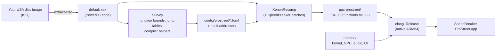
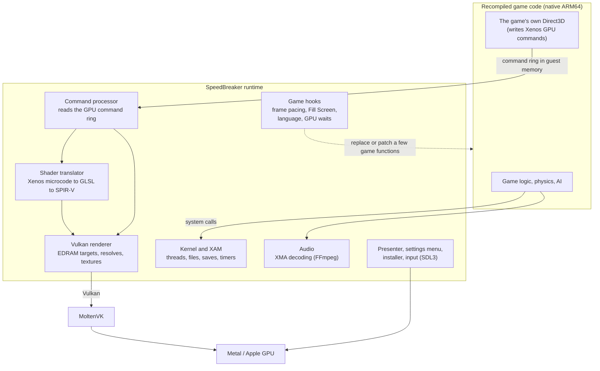

# SpeedBreaker: ProStreet

*Need for Speed: ProStreet* (EA Black Box, 2007), the Xbox 360 version, running natively on
Apple Silicon Macs.

This is a fork of [SpeedBreaker: Carbon](https://github.com/SpeedBreakerProject/speedbreaker-carbon)
by **project(u)**, who also made [SpeedBreaker](https://github.com/SpeedBreakerProject/speedbreaker)
for *Most Wanted*. Their projects translate an Xbox 360 game's code into native code and run it on
a runtime that stands in for the console. Nearly everything here is their work: the recompiler
setup, the console's kernel and GPU emulation, the Vulkan renderer, the installer and the settings
menu. This fork adds ProStreet to it as a third game. All thanks go to project(u) and to the
projects they build on (see [Credits](#credits)).

## Status

This project is an experiment based on the existing ports. It runs smoothly (60 fps on an M1 Pro)
and the race modes tried so far (grip, drift, drag, speed, time attack) play without known
problems. But:

- It is **not actively supported**. The author works on it only when time allows.
- The game has **not been played from start to finish** on it, so issues may remain.
- macOS on Apple Silicon only (the same code may build on Linux or Windows as the originals do,
  but nobody has tried). Offline only; two-player split screen hasn't been looked at.

How the port was made, step by step: [docs/PROSTREET_SURVEY.md](docs/PROSTREET_SURVEY.md).
Changes per version: [CHANGELOG-prostreet.md](CHANGELOG-prostreet.md).

## Screenshots

| | |
|---|---|
|  |  |
|  |  |

## Install

You need an **Apple Silicon Mac with macOS 15 or newer** and your own disc image (ISO) of the
**USA Xbox 360 release** of *Need for Speed: ProStreet* (English and Spanish). Other regions and
the PC, PS3 and Wii versions don't work. No game files are included.

1. Download `SpeedBreaker-ProStreet-macos.dmg` from
   [Releases](https://github.com/sanyokkua/speedbreaker-prostreet/releases/latest), open it and
   drag **SpeedBreaker ProStreet** to Applications.
2. **Open it.** The app isn't notarized by Apple, so the first time macOS refuses. Close that
   message (don't move the app to the Trash), go to **System Settings > Privacy & Security**,
   scroll to the message about SpeedBreaker ProStreet, click **Open Anyway** and confirm. Once
   per new download.
3. **Put your disc image in a `Games` folder in your home folder** (`~/Games`), where the app
   looks by itself, or choose it anywhere with *Browse for image...*.
4. **Install.** The app checks the image (its `default.xex` must be the USA release's) and
   installs the game, about 7.5 GB, into `~/Library/Application Support/SpeedBreaker ProStreet`.
   You can delete the ISO afterwards. Saves and settings live in that folder too.

Settings: **F1** or **Cmd+,**, or Back + Start on a controller. On an M1 Pro, Internal
Resolution 2x with Bicubic upscaling and 1x shadows holds 60 fps; FSR 1 and 2x shadows cost GPU
time. The menus can be shown in any of the 15 languages on the disc (Settings > Game); speech and
movies stay English.

**Known issues:** with Fill Screen on a 16:10 screen, some full-screen menu overlays don't reach
the top and bottom edges.

## How it works

The Xbox 360 runs PowerPC code on a custom ATI GPU (Xenos). There is no emulator here: the
game's executable is translated once, ahead of time, into C++ that compiles to native ARM64. The
runtime then provides what the console would: its kernel and system calls, memory, threads,
files, audio, input, and a GPU that accepts the game's Xenos commands and draws them with Vulkan.

### Build time: from the disc to an app



The generated C++ is the game's code, so it is never stored in this repository. Each build makes
it from your own disc, and GitHub can't build releases for the same reason.

### Run time: what happens while you play



- **Memory.** The game sees a 4 GB big-endian address space, as on the console. The GPU reads
  it directly, and writes are tracked page by page so the CPU and GPU see each other's data in
  the right order.
- **Threads.** Each guest thread is a host thread. ProStreet relies on the console's store
  ordering between threads, so its build orders memory accesses as x86 does (`SB_GUEST_TSO`).
- **Graphics.** The Xenos GPU's EDRAM render targets, tiled rendering and resolves are mapped
  onto Vulkan images, and its shaders are translated when first used and cached.
- **Hooks.** A handful of the game's functions are replaced or patched by address: whole display
  refreshes for game time, Hor+/Vert+ for other screen shapes, the menu language, and backing off
  instead of spinning while the game waits for the GPU. ProStreet's addresses were found by
  matching Carbon's code, the same engine one year older.

## Build from source (macOS, Apple Silicon)

Needs Xcode's command line tools and, from Homebrew, `brew install llvm lld cmake ninja molten-vk`.

```sh
scripts/setup_tools.sh    # XenonRecomp + SpeedBreaker's patches, extract-xiso, FFmpeg's XMA decoder

# Extract your disc image into game-prostreet/files and check the executable.
mkdir -p game-prostreet/files
tools/extract-xiso/build/extract-xiso -d game-prostreet/files -x "/path/to/Need for Speed - ProStreet (USA) (En,Es).iso"
shasum -a 256 game-prostreet/files/default.xex
# must print 4f8b623a2a1ed06555b57da4e70411574ac962bce4b81bb100629ecc518275c2

# Translate the game's code into C++ (writes ppc-prostreet/, about 170 MB).
mkdir -p ppc-prostreet
tools/XenonRecomp/build/XenonRecomp/XenonRecomp config/prostreet/prostreet.toml tools/XenonRecomp/XenonUtils/ppc_context.h

# The libraries the app bundles, from their official sources, for macOS 15 and newer.
scripts/macos/build_deps.sh build/deps

cmake -S . -B build/release -G Ninja -DCMAKE_BUILD_TYPE=Release -DSB_GAME=prostreet \
  -DCMAKE_C_COMPILER=/opt/homebrew/opt/llvm/bin/clang \
  -DCMAKE_CXX_COMPILER=/opt/homebrew/opt/llvm/bin/clang++ \
  -DCMAKE_PREFIX_PATH="$PWD/build/deps" -DFFMPEG_XMA="$PWD/build/deps/ffmpeg-xma"
ninja -C build/release

# The app and its dmg, in build/app-release.
python3 scripts/macos/make_app.py build/release build/app-release --dmg --min-macos=15.0
```

Run a build straight from the extracted files:

```sh
NFSMW_GAME_DIR="$PWD/game-prostreet/files" build/release/runtime/SpeedBreaker
```

Tests: `ctest --test-dir build/release` (`swapchain_use_test` can fail under a full parallel run
and passes alone) and `tests/run_instr_tests.sh` for the recompiler's instructions.

The original SpeedBreaker: Carbon README, with its Linux, SteamOS and Windows instructions, is
kept as [README-carbon.md](README-carbon.md).

## What ProStreet needed

Beyond SpeedBreaker: Carbon, in short (details in [docs/PROSTREET_SURVEY.md](docs/PROSTREET_SURVEY.md)):

- **Recompiling:** three PowerPC vector instructions XenonRecomp didn't know, and hand fixes to
  a few jump tables and function bounds.
- **Booting:** four kernel calls the other games never made, such as checking whether a thread
  has exited.
- **Graphics:** a depth clear that also clears the depth targets sharing its EDRAM (tire smoke),
  pixel shaders that write depth (smoke behind cars, cars behind walls), and copying large
  vertex buffers the game refills every frame instead of waiting for the GPU (a dropped frame
  every second).
- **Threads:** x86-style memory ordering (single wrong frames in busy scenes).
- **Parity with Carbon:** game time in whole display refreshes, GPU-wait back-off, the sound
  mixer's CPU budget, Fill Screen, the language setting and Shadow Resolution.
- **Not applicable:** HDR highlights (ProStreet draws its scene in 8 bits), nitrous light trails
  (drawn differently) and movie pacing (VP6 movies, decoded by the game).

## Diagnostics

- `Cmd+D` (or `NFSMW_DRAW_LOG_AT=<seconds>`): log every draw of the next frame with its render
  state, to the session log in `~/Library/Application Support/SpeedBreaker ProStreet/logs`.
- `NFSMW_LOG_GUARD=<seconds>`, `NFSMW_LOG_D3D_WAIT=1`, `NFSMW_GAME_TIME_LOG=<file>`: what the game
  waits on, its GPU waits, and its frame times.
- Settings > Advanced > Save Bug Report: the log and system details on the Desktop.

## Credits

**SpeedBreaker and SpeedBreaker: Carbon are made by project(u)**
([SpeedBreakerProject](https://github.com/SpeedBreakerProject), [projectugarte.com](https://projectugarte.com/)).
This port exists only because of their engine and their well-documented approach. The ProStreet
additions in this fork are by [sanyokkua](https://github.com/sanyokkua).

project(u) in turn thank the **hedge-dev** team, for XenonRecomp and the approach Unleashed
Recompiled pioneered, and the **Xenia** project, for a decade of Xbox 360 research. The
open-source projects in this build:

| Project | What it's used for | License |
|---|---|---|
| [SpeedBreaker](https://github.com/SpeedBreakerProject/speedbreaker) and [SpeedBreaker: Carbon](https://github.com/SpeedBreakerProject/speedbreaker-carbon) (project(u) and contributors) | The runtime, renderer, installer and tools this fork builds on | GPL-3.0-or-later |
| [XenonRecomp](https://github.com/hedge-dev/XenonRecomp) (hedge-dev and contributors) | The PowerPC-to-C++ recompiler; its XenonUtils (XEX loading) | MIT |
| [Unleashed Recompiled](https://github.com/hedge-dev/UnleashedRecomp) (hedge-dev and contributors) | Parts of the kernel, XAM, memory and threading code | GPL-3.0-or-later |
| [Xenia](https://github.com/xenia-project/xenia) (Ben Vanik and Xenia contributors) | GPU register, microcode and Xenos headers; the reference for kernel, XMA and GPU behaviour | BSD-3-Clause |
| freedreno (Rob Clark) | Code inside the ported microcode header | MIT |
| [FFmpeg](https://ffmpeg.org/) 7.1.1 | XMA audio decoding (a decoder-only static build with a SpeedBreaker patch) | LGPL-2.1-or-later |
| [SDL3](https://www.libsdl.org/) | Windows, input, audio, app lifecycle | zlib |
| [Dear ImGui](https://github.com/ocornut/imgui) (Omar Cornut) | The installer and settings UI | MIT |
| [Roboto](https://fonts.google.com/specimen/Roboto) (Google) | The UI font | Apache-2.0 |
| [FidelityFX Super Resolution 1](https://github.com/GPUOpen-Effects/FidelityFX-FSR) (AMD) | FSR 1 upscaling | MIT |
| [o1heap](https://github.com/pavel-kirienko/o1heap) (Pavel Kirienko) | The guest heap allocator | MIT |
| [glslang](https://github.com/KhronosGroup/glslang) and [SPIRV-Tools](https://github.com/KhronosGroup/SPIRV-Tools) (Khronos) | Shader compilation at runtime | BSD-3-Clause and others; Apache-2.0 |
| [MoltenVK](https://github.com/KhronosGroup/MoltenVK) and the [Vulkan Loader](https://github.com/KhronosGroup/Vulkan-Loader) (Khronos) | Vulkan on a Mac | Apache-2.0 |
| [toml++](https://github.com/marzer/tomlplusplus) (Mark Gillard) | `settings.toml` | MIT |
| [SIMDe](https://github.com/simd-everywhere/simde) (Evan Nemerson and contributors) | SIMD in the recompiled code | MIT |
| [libmspack](https://github.com/kyz/libmspack) (Stuart Caie) | LZX decompression | LGPL-2.1 |
| [tiny-AES-c](https://github.com/kokke/tiny-AES-c) | XEX decryption | Unlicense |
| [TinySHA1](https://github.com/mohaps/TinySHA1) (Saurav Mohapatra) | SHA-1, via XenonUtils | ISC-style |
| [extract-xiso](https://github.com/XboxDev/extract-xiso) | Developer tool for unpacking disc images (not shipped) | Its own license |

Full license texts are in [THIRD_PARTY_NOTICES.md](THIRD_PARTY_NOTICES.md) and [LICENSES/](LICENSES/),
and in the app at `SpeedBreaker ProStreet.app/Contents/Resources/licenses`. The source code of
the LGPL parts in the app (FFmpeg with SpeedBreaker's patch, and libmspack) is published next to
each release, as `SpeedBreaker-ProStreet-<version>-third-party-source.tar.xz`.

## License

Free software under the **GNU General Public License**, version 3 or (at your option) any later
version (GPL-3.0-or-later), as SpeedBreaker. See [COPYING](COPYING) and [NOTICE](NOTICE).
Third-party components keep their own licenses, listed above.

Copyright (C) 2026 project(u) and SpeedBreaker contributors; ProStreet additions (C) 2026
sanyokkua.

## Legal notice

SpeedBreaker: ProStreet is an unofficial, fan-made project. It is **not affiliated with, endorsed
by or sponsored by Electronic Arts Inc., the Need for Speed brand, Microsoft or project(u).**

"Need for Speed" and "ProStreet" are trademarks of Electronic Arts Inc. Xbox and Xbox 360 are
trademarks of Microsoft. All other trademarks, including PlayStation, Apple, Mac, macOS, Vulkan
and AMD, belong to their respective owners and are used only to describe what this works with.
The screenshots are from the author's own play on this port and show the game only to document
that it runs.

**No game files are included or distributed.** This project contains no game data or assets: no
textures, models, audio, movies or disc files. To play, you need your own legally obtained backup
(a disc image) of your own Xbox 360 disc of *Need for Speed: ProStreet* (2007), the USA release.
The in-app installer verifies it and installs it.

Provided "as is", without warranty of any kind, as set out in the GNU General Public License.
