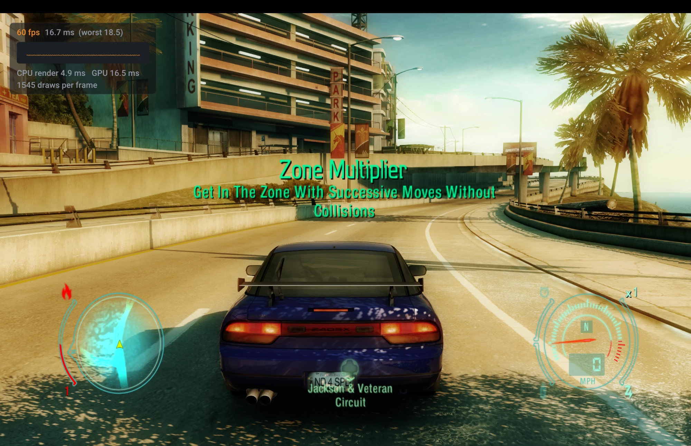
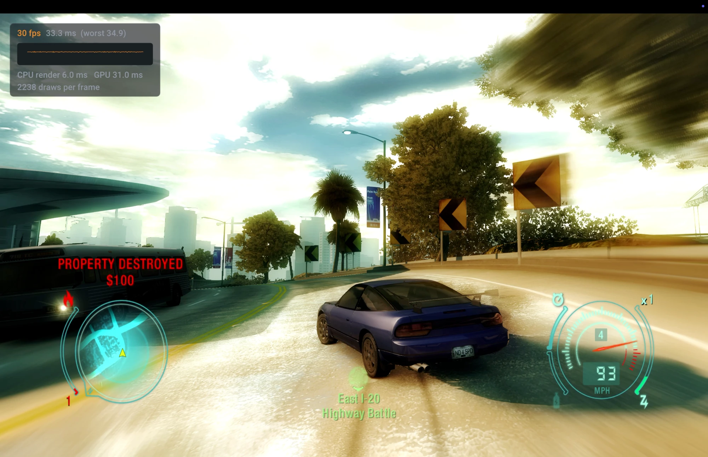
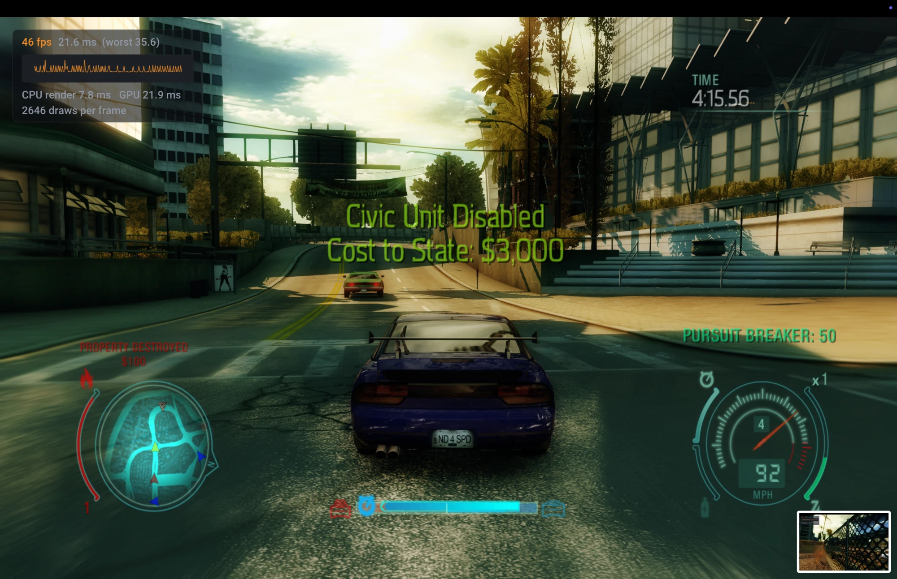
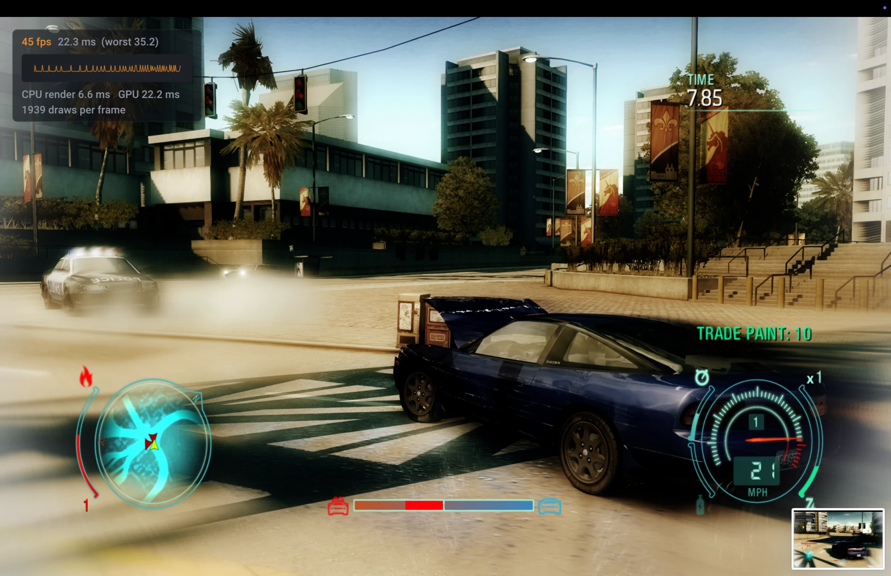
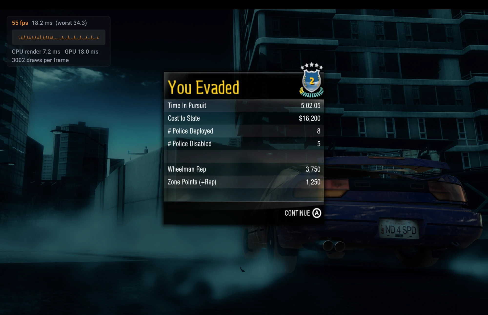
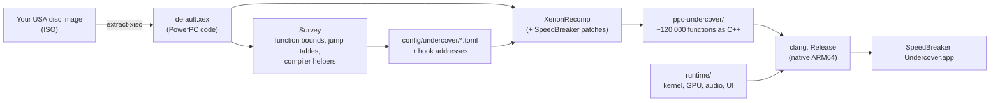
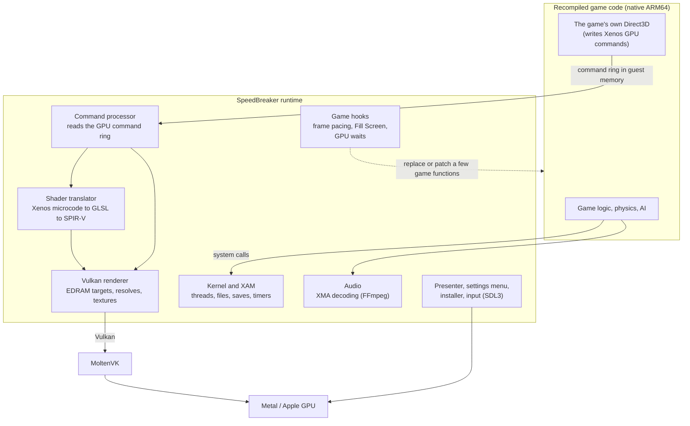

# SpeedBreaker: Undercover

*Need for Speed: Undercover* (EA Black Box, 2008), the Xbox 360 version, running natively on
Apple Silicon Macs.

This is a fork of [SpeedBreaker: Carbon](https://github.com/SpeedBreakerProject/speedbreaker-carbon)
by **project(u)**, who also made [SpeedBreaker](https://github.com/SpeedBreakerProject/speedbreaker)
for *Most Wanted*. It grew out of SpeedBreaker: ProStreet, the same author's earlier fork of
theirs ([README-prostreet.md](README-prostreet.md)). Their projects translate an Xbox 360 game's
code into native code and run it on a runtime that stands in for the console. Nearly everything
here is their work: the recompiler setup, the console's kernel and GPU emulation, the Vulkan
renderer, the installer and the settings menu. This fork adds Undercover to it. All thanks go to
project(u) and to the projects they build on (see [Credits](#credits)).

## Status

This project is an experiment based on the existing ports. Free roam and the races tried so far
play, at 60 fps in quieter scenes and between 30 and 60 fps in busy races and free roam on an
M1 Pro (the Xbox 360 itself runs the game at 30). But:

- It is **not actively supported**. The author works on it only when time allows.
- The game has **not been played from start to finish** on it, so issues may remain.
- macOS on Apple Silicon only (the same code may build on Linux or Windows as the originals do,
  but nobody has tried). Offline only; split screen hasn't been looked at.

How the port was made: [docs/UNDERCOVER_SURVEY.md](docs/UNDERCOVER_SURVEY.md).
Changes per version: [CHANGELOG-undercover.md](CHANGELOG-undercover.md).

## Screenshots

From the author's play on an M1 Pro (Internal Resolution Auto, with the frame-rate overlay on).

| | |
|---|---|
|  |  |
|  |  |
|  | |

## Install

You need an **Apple Silicon Mac with macOS 15 or newer** and your own disc image (ISO) of the
**USA Xbox 360 release** of *Need for Speed: Undercover* (English, French and Spanish). Other
regions and the PC, PS3, PS2 and Wii versions don't work. No game files are included.

1. Download `SpeedBreaker-Undercover-macos.dmg` from
   [Releases](https://github.com/sanyokkua/speedbreaker-undercover/releases/latest), open it and
   drag **SpeedBreaker Undercover** to Applications.
2. **Open it.** The app isn't notarized by Apple, so the first time macOS refuses. Close that
   message (don't move the app to the Trash), go to **System Settings > Privacy & Security**,
   scroll to the message about SpeedBreaker Undercover, click **Open Anyway** and confirm.
3. **Put your disc image in a `Games` folder in your home folder** (`~/Games`), where the app
   looks by itself, or choose it anywhere with *Browse for image...*.
4. **Install.** The app checks the image (its `default.xex` must be the USA release's) and
   installs the game, about 5 GB, into `~/Library/Application Support/SpeedBreaker Undercover`.
   You can delete the ISO afterwards. Saves and settings live in that folder too.

Settings: **F1** or **Cmd+,**, or Back + Start on a controller. On an M1 Pro, keep Internal
Resolution on **Auto** (1.5x); 2x costs too much GPU time in this game, and 1x holds 60 fps
nearly everywhere. For the console's
picture, leave **HDR Output off** and **Xbox 360 Display Gamma on**.

**Known issues:**

- Busy races and free roam run between 30 and 60 fps on an M1 Pro: the GPU is the limit.
- Rarely the game may close in its first seconds (about 1 start in 40 before a guard was
  added); start it again.
- Now and then a sign, a building's texture or the car paint's reflection disappears for one frame.
- With HDR Output on, the brightest whites clip.
- Smoke in front of cars can look slightly off.
- No Language setting: the menus follow the disc's language.

## How it works

The Xbox 360 runs PowerPC code on a custom ATI GPU (Xenos). There is no emulator here: the
game's executable is translated once, ahead of time, into C++ that compiles to native ARM64. The
runtime then provides what the console would: its kernel and system calls, memory, threads,
files, audio, input, and a GPU that accepts the game's Xenos commands and draws them with Vulkan.

### Build time: from the disc to an app



The generated C++ is the game's code, so it is never stored in this repository. Each build makes
it from your own disc, and GitHub can't build releases for the same reason.

### Run time: what happens while you play



- **Memory.** The game sees a 4 GB big-endian address space, as on the console. The GPU reads
  it directly, and writes are tracked page by page so the CPU and GPU see each other's data in
  the right order.
- **Threads.** Each guest thread is a host thread, told which of the console's six hardware
  threads it runs on (the game keeps per-processor data). Like ProStreet, Undercover relies on
  the console's store ordering between threads, so its build orders memory accesses as x86 does
  (`SB_GUEST_TSO`).
- **Graphics.** The Xenos GPU's EDRAM render targets, tiled rendering and resolves are mapped
  onto Vulkan images, and its shaders are translated when first used and cached.
- **Hooks.** A handful of the game's functions are replaced or patched by address: whole display
  refreshes for game time, Hor+/Vert+ for other screen shapes, and backing off instead of spinning
  while the game waits for the GPU. Undercover's addresses were found by matching ProStreet's
  code, the same engine one year older.

## Build from source (macOS, Apple Silicon)

Needs Xcode's command line tools and, from Homebrew, `brew install llvm lld cmake ninja molten-vk`.

```sh
scripts/setup_tools.sh    # XenonRecomp + SpeedBreaker's patches, extract-xiso, FFmpeg's XMA decoder

# Extract your disc image into game-undercover/files and check the executable.
mkdir -p game-undercover && cd game-undercover
../tools/extract-xiso/build/extract-xiso -x "/path/to/Need for Speed - Undercover (USA) (En,Fr,Es).iso"
mv "Need for Speed - Undercover (USA) (En,Fr,Es)" files && cd ..
shasum -a 256 game-undercover/files/default.xex
# must print 97ac0c072253d46458dc6d57c6609922adbd3b9658216940282c361ad575e221

# Translate the game's code into C++ (writes ppc-undercover/, about 260 MB, ~120,000 functions).
mkdir -p ppc-undercover
tools/XenonRecomp/build/XenonRecomp/XenonRecomp config/undercover/undercover.toml tools/XenonRecomp/XenonUtils/ppc_context.h

# The libraries the app bundles, from their official sources, for macOS 15 and newer.
scripts/macos/build_deps.sh build/deps

cmake -S . -B build/release -G Ninja -DCMAKE_BUILD_TYPE=Release -DSB_GAME=undercover \
  -DCMAKE_C_COMPILER=/opt/homebrew/opt/llvm/bin/clang \
  -DCMAKE_CXX_COMPILER=/opt/homebrew/opt/llvm/bin/clang++ \
  -DCMAKE_PREFIX_PATH="$PWD/build/deps" -DFFMPEG_XMA="$PWD/build/deps/ffmpeg-xma"
ninja -C build/release

# The app and its dmg, in build/app-release.
python3 scripts/macos/make_app.py build/release build/app-release --dmg --min-macos=15.0
```

Run a build straight from the extracted files:

```sh
NFSMW_GAME_DIR="$PWD/game-undercover/files" build/release/runtime/SpeedBreaker
```

Tests: `ctest --test-dir build/release` (`swapchain_use_test` can fail under a full parallel run
and passes alone) and `tests/run_instr_tests.sh` for the recompiler's instructions.

The ProStreet build (`-DSB_GAME=prostreet`) still works from this tree; see
[README-prostreet.md](README-prostreet.md). The original SpeedBreaker: Carbon README, with its
Linux, SteamOS and Windows instructions, is kept as [README-carbon.md](README-carbon.md).

## What Undercover needed

Beyond SpeedBreaker: ProStreet, in short (details in [docs/UNDERCOVER_SURVEY.md](docs/UNDERCOVER_SURVEY.md)):

- **Recompiling:** a vector instruction XenonRecomp didn't know, a disassembler fix (an old
  PowerPC 405 instruction matched before Xenon's vector one), a data table inside the code
  section, and jump tables and secondary entry points the survey scripts now find.
- **Booting:** setting a thread's processor number when the game pins it to a core; the job
  threads index per-processor data by it.
- **Graphics:** a texture-filtering shader instruction (cars and road), and copying the textures
  and vertex buffers the game rewrites every frame instead of waiting for the GPU, but never a
  texture the GPU itself draws into (that caused the blinking).
- **Parity:** game time in whole display refreshes, GPU-wait back-off, the sound mixer's CPU
  budget and Fill Screen, at Undercover's own addresses.
- **Not applicable:** Shadow Resolution (no 1600x1600 sun shadow map); the Language setting
  (its table wasn't found yet).

## Diagnostics

- `Cmd+D` (or `NFSMW_DRAW_LOG_AT=<seconds>`, with `NFSMW_DRAW_LOG_FRAMES=<n>` for several
  frames): log every draw with its render state, to the session log in
  `~/Library/Application Support/SpeedBreaker Undercover/logs`.
- `NFSMW_DUMP_FRAMES=<dir>` with `NFSMW_DUMP_EVERY=1` and `NFSMW_DUMP_FROM=<frame>`: consecutive
  frames as images, for flicker.
- `NFSMW_LOG_GUARD=<seconds>`, `NFSMW_LOG_D3D_WAIT=1`, `NFSMW_GAME_TIME_LOG=<file>`: what the game
  waits on, its GPU waits, and its frame times.
- Settings > Advanced > Save Bug Report: the log and system details on the Desktop.

## Credits

**SpeedBreaker and SpeedBreaker: Carbon are made by project(u)**
([SpeedBreakerProject](https://github.com/SpeedBreakerProject), [projectugarte.com](https://projectugarte.com/)).
This port exists only because of their engine and their well-documented approach. The ProStreet
and Undercover additions in this fork are by [sanyokkua](https://github.com/sanyokkua).

project(u) in turn thank the **hedge-dev** team, for XenonRecomp and the approach Unleashed
Recompiled pioneered, and the **Xenia** project, for a decade of Xbox 360 research. The
open-source projects in this build:

| Project | What it's used for | License |
|---|---|---|
| [SpeedBreaker](https://github.com/SpeedBreakerProject/speedbreaker) and [SpeedBreaker: Carbon](https://github.com/SpeedBreakerProject/speedbreaker-carbon) (project(u) and contributors) | The runtime, renderer, installer and tools this fork builds on | GPL-3.0-or-later |
| [XenonRecomp](https://github.com/hedge-dev/XenonRecomp) (hedge-dev and contributors) | The PowerPC-to-C++ recompiler; its XenonUtils (XEX loading) | MIT |
| [Unleashed Recompiled](https://github.com/hedge-dev/UnleashedRecomp) (hedge-dev and contributors) | Parts of the kernel, XAM, memory and threading code | GPL-3.0-or-later |
| [Xenia](https://github.com/xenia-project/xenia) (Ben Vanik and Xenia contributors) | GPU register, microcode and Xenos headers; the reference for kernel, XMA and GPU behaviour | BSD-3-Clause |
| freedreno (Rob Clark) | Code inside the ported microcode header | MIT |
| [FFmpeg](https://ffmpeg.org/) 7.1.1 | XMA audio decoding (a decoder-only static build with a SpeedBreaker patch) | LGPL-2.1-or-later |
| [SDL3](https://www.libsdl.org/) | Windows, input, audio, app lifecycle | zlib |
| [Dear ImGui](https://github.com/ocornut/imgui) (Omar Cornut) | The installer and settings UI | MIT |
| [Roboto](https://fonts.google.com/specimen/Roboto) (Google) | The UI font | Apache-2.0 |
| [FidelityFX Super Resolution 1](https://github.com/GPUOpen-Effects/FidelityFX-FSR) (AMD) | FSR 1 upscaling | MIT |
| [o1heap](https://github.com/pavel-kirienko/o1heap) (Pavel Kirienko) | The guest heap allocator | MIT |
| [glslang](https://github.com/KhronosGroup/glslang) and [SPIRV-Tools](https://github.com/KhronosGroup/SPIRV-Tools) (Khronos) | Shader compilation at runtime | BSD-3-Clause and others; Apache-2.0 |
| [MoltenVK](https://github.com/KhronosGroup/MoltenVK) and the [Vulkan Loader](https://github.com/KhronosGroup/Vulkan-Loader) (Khronos) | Vulkan on a Mac | Apache-2.0 |
| [toml++](https://github.com/marzer/tomlplusplus) (Mark Gillard) | `settings.toml` | MIT |
| [SIMDe](https://github.com/simd-everywhere/simde) (Evan Nemerson and contributors) | SIMD in the recompiled code | MIT |
| [libmspack](https://github.com/kyz/libmspack) (Stuart Caie) | LZX decompression | LGPL-2.1 |
| [tiny-AES-c](https://github.com/kokke/tiny-AES-c) | XEX decryption | Unlicense |
| [TinySHA1](https://github.com/mohaps/TinySHA1) (Saurav Mohapatra) | SHA-1, via XenonUtils | ISC-style |
| [extract-xiso](https://github.com/XboxDev/extract-xiso) | Developer tool for unpacking disc images (not shipped) | Its own license |

Full license texts are in [THIRD_PARTY_NOTICES.md](THIRD_PARTY_NOTICES.md) and [LICENSES/](LICENSES/),
and in the app at `SpeedBreaker Undercover.app/Contents/Resources/licenses`. The source code of
the LGPL parts in the app (FFmpeg with SpeedBreaker's patch, and libmspack) is published next to
each release, as `SpeedBreaker-Undercover-<version>-third-party-source.tar.xz`.

## License

Free software under the **GNU General Public License**, version 3 or (at your option) any later
version (GPL-3.0-or-later), as SpeedBreaker. See [COPYING](COPYING) and [NOTICE](NOTICE).
Third-party components keep their own licenses, listed above.

Copyright (C) 2026 project(u) and SpeedBreaker contributors; ProStreet and Undercover additions
(C) 2026 sanyokkua.

## Legal notice

SpeedBreaker: Undercover is an unofficial, fan-made project. It is **not affiliated with, endorsed
by or sponsored by Electronic Arts Inc., the Need for Speed brand, Microsoft or project(u).**

"Need for Speed" and "Undercover" are trademarks of Electronic Arts Inc. Xbox and Xbox 360 are
trademarks of Microsoft. All other trademarks, including PlayStation, Apple, Mac, macOS, Vulkan
and AMD, belong to their respective owners and are used only to describe what this works with.
The screenshots are from the author's own play on this port and show the game only to document
that it runs.

**No game files are included or distributed.** This project contains no game data or assets: no
textures, models, audio, movies or disc files. To play, you need your own legally obtained backup
(a disc image) of your own Xbox 360 disc of *Need for Speed: Undercover* (2008), the USA release.
The in-app installer verifies it and installs it.

Provided "as is", without warranty of any kind, as set out in the GNU General Public License.
